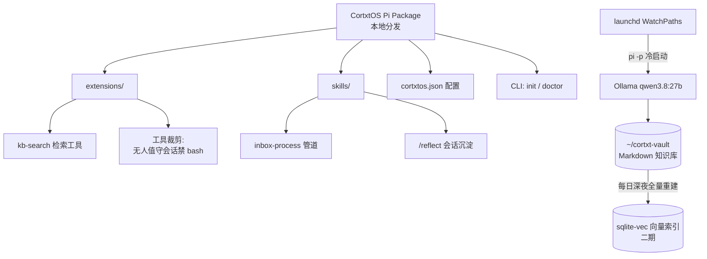

# CortxtOS 设计文档

> 基于 Pi Agent Harness 的本地优先（Local-First）个人 AI 工作台
>
> 版本：v1.0（设计拷问定稿）｜日期：2026-11-05｜状态：待实施

---

## 1. 产品定位

CortxtOS 将个人计算机升级为具有高级认知能力的"大脑皮层操作系统"，融合三大能力：

- **深度知识库管理**：本地 Markdown vault + 自动沉淀 + 检索增强问答
- **高阶自动化工作流**：事件驱动的 inbox 处理管道 + Skills 化 SOP
- **全能多模态路由调度**：文本/图像/音频输入，规则式档位路由到本地 Ollama 模型

**用户画像**：极客与专业开发者。第一阶段用户就是作者本人。

**构建原则**：

- 为自己构建，按可发布标准写（配置外置、README 从第一天写）
- **不做**：安装包、跨平台（仅 macOS）、UI 打磨、云端分发
- 分发方式：**本地分发** —— 本地 git 版本管理，Pi package 通过本地路径安装/软链到 `~/.pi/`

## 2. 核心边界与设计哲学

| 维度 | 决策 |
|------|------|
| Local-First 含义 | 数据主权 100% 本地（知识库/会话/工作流全在本地磁盘）；算力当前全本地（Ollama），云端 provider 仅保留接口位，默认关闭 |
| 与 Pi 的关系 | Pi 负责 Agent Loop / 工具 / 上下文 / Session；CortxtOS = Pi package（extensions + skills + CLI）。一期做 package，工作台 UI 面板放二期 |
| 技术栈 | TypeScript 为主（与 Pi 同栈）；whisper.cpp 等本地 ML 工具以子进程形式调用 |
| 环境要求 | Node ≥ 22.19（需 `nvm install 22`）、Pi CLI（`curl -fsSL https://pi.dev/install.sh \| sh`）、Ollama、macOS |
| 设计哲学 | 如无必要，勿增实体——能用文件系统 + grep 解决的不自建数据库；能用 launchd 冷启动解决的不自建守护进程 |

## 3. 架构总览



### 3.1 仓库结构（标准 Pi package 布局）

```
cortxtos/
├── package.json          # 包名 cortxtos，本地 git 分发
├── tsconfig.json
├── README.md             # 第一天就写
├── DESIGN.md             # 本文档
├── bin/
│   └── cortxtos.ts       # CLI 入口：init / doctor
├── extensions/
│   ├── kb-search.ts      # 知识库检索 tool（一期文件版）
│   └── session-guard.ts  # 按会话类型裁剪工具集（无人值守禁 bash）
├── skills/
│   ├── inbox-process/    # PDF/图片/音频 → 摘要 note + 自动标签
│   │   └── SKILL.md
│   └── reflect/          # /reflect 会话反思沉淀 → daily/
│       └── SKILL.md
├── launchd/
│   ├── com.cortxtos.inbox.plist    # WatchPaths → pi -p
│   └── com.cortxtos.reindex.plist  # 每日深夜全量重建向量索引（二期挂载）
├── prompts/              # Pi prompt templates（可选）
└── src/                  # 共享 TS 模块：config / vault / routing / asr
```

### 3.2 运行形态

一期采用 Pi 的两种使用方式：

1. **交互式 TUI**：`cd ~/cortxt-vault && pi`，装载 cortxtos package（extensions + skills）
2. **无人值守 print 模式**：launchd 事件触发 `pi -p "<处理指令>"`，冷启动、无守护进程

二期（明确排除出一期）：用 Pi TypeScript SDK / RPC 嵌入独立工作台 UI 面板。

## 4. 知识库规范（第一天锁定，避免迁移）

### 4.1 vault 目录

vault 根默认 `~/cortxt-vault/`，可通过 `cortxtos.json` 的 `vaultPath` 覆盖。

```
~/cortxt-vault/
├── inbox/       # 投喂区：拖入 PDF/图片/音频，watcher 自动处理
├── notes/       # 沉淀区：按主题二级目录（notes/编程/xxx.md）
├── daily/       # 每日日志：YYYY-MM-DD.md，/reflect 产出追加于此
└── workflows/   # 自动化产出归档
```

- 存量笔记库（Obsidian 等）直接指为 vault，由一次性 migration 脚本补 frontmatter，不新建空库。

### 4.2 note frontmatter schema（最小字段集）

```yaml
---
title: 笔记标题
tags: [标签A, 标签B]
created: 2026-11-05T10:00:00+08:00
source: inbox-pdf | manual | reflect | audio | video   # video 仅留枚举位，一期不做管道
type: note | summary | log | workflow-output
---
```

- 一期检索 = grep + frontmatter 过滤（`kb-search` 文件版），零向量基建。
- 二期加向量索引时不迁移格式，只在写入函数中预留 `on_note_written()` 空钩子。

## 5. 模型与路由（全本地 Ollama）

### 5.1 路由表结构（保留档位抽象，当前全部指向本地）

`cortxtos.json`：

```jsonc
{
  "vaultPath": "~/cortxt-vault",
  "ollama": { "baseUrl": "http://localhost:11434", "maxLoadedModels": 1 },
  "tiers": {
    "fast":     { "model": "qwen3.8:<小杯>",              "fallback": ["balanced"] },
    "balanced": { "model": "qwen3.8:27b-mlx|iq4_xs",      "fallback": ["heavy"] },
    "heavy":    { "model": "qwen3.8:27b-mlx|iq4_xs(thinking=on)", "fallback": [] },
    "vision":   { "model": "qwen3.8:27b（原生视觉）",       "fallback": ["balanced"] },
    "embedding":{ "model": "qwen3-embedding:0.6b" }
  },
  "asr": { "engine": "whisper.cpp", "model": "large-v3" }
}
```

- **规则式路由**：档位由 skill/工作流定义中**静态声明** + TUI 内手动 `/model` 切换；**禁止** LLM 自评任务复杂度自动路由。
- 档位表第一天就存在，未来接入云端 key 只改配置不改代码。
- Pi 自带 `@earendil-works/pi-ai` 多 provider 统一 API 与 Ollama 支持——provider 归一层**不重造**。

### 5.2 多模态能力矩阵

| 模态 | 方案 | 期数 |
|------|------|------|
| 文本 | qwen3.8:27b | 一期 |
| 图片 | qwen3.8:27b 原生视觉（无需额外模型） | 一期 |
| 音频 | whisper.cpp 本地转写 → 文本进 27B 提炼入知识库 | 一期 |
| 视频 | qwen3.8 原生支持但**不进验收标准**：不写专用代码，仅 `source` 字段留 `video` 枚举 | 按需 |

### 5.3 硬件自适应（cortxtos doctor）

- 模型变体是配置项，`doctor` 首跑通过 `sysctl hw.memsize` 检测统一内存并生成默认值：
  - ≥36GB → `qwen3.8:27b-mlx`（Apple Silicon 优化）
  - 24~35GB → `qwen3.8:27b-iq4_xs`
  - <24GB → 警告 + 建议降尺寸（14B/9B 级），配置可一键覆盖
- **并发策略**：`OLLAMA_MAX_LOADED_MODELS=1`，watcher 任务与交互会话排队，接受分钟级延迟（异步管道无人等待）。

### 5.4 向量检索（二期，接口第一天锁定）

- embedding：Ollama `qwen3-embedding:0.6b`（中文优先），计算 100% 本地不出网；云端 embedding 仅显式 opt-in。
- 索引：`sqlite-vec` 单文件，存放于 vault **外**的缓存目录（可随时全量重建，无数据主权损失）。
- 更新策略：**每日深夜 launchd 定时全量重建**（个人 vault 千级规模够用），不做增量索引。

## 6. 自动化工作流

### 6.1 触发模型（一期只做两类）

| 类型 | 方案 | 产品化程度 |
|------|------|-----------|
| Skills 型 | SOP 写成 SKILL.md，按需加载（Pi 原生） | 一期核心 |
| 事件型 | launchd `WatchPaths` 监听 `inbox/` → `pi -p` 冷启动处理 | 一期核心 |
| 定时型 | 系统 launchd 直接跑，不做产品化封装 | 糊一下即可 |
| 编排型（agent 调 agent DAG） | Pi 无内置 sub-agent，需自建 extension | **二期以后** |

### 6.2 inbox-process 管道

```
文件落入 inbox/ → launchd 触发 → pi -p（无人值守会话，工具已裁剪）
  ├─ PDF    → 文本抽取 → fast 档摘要+打标签 → notes/ 写入 note
  ├─ 图片   → vision 档理解 → 同上
  ├─ 音频   → whisper.cpp 转写 → fast 档提炼 → 同上
  └─ 处理完的原文件移至 workflows/ 归档
```

### 6.3 记忆沉淀

- `/reflect` skill：会话中手动触发，agent 反思本次会话中有长期价值的信息，蒸馏成条目追加到 `daily/YYYY-MM-DD.md`。
- 先手动养成习惯（一两周观察蒸馏质量），**全自动 session 结束触发不进一期**。

## 7. 安全边界（无人值守会话）

Pi 刻意无内置权限系统；处理任意 inbox 文件存在 prompt injection 风险（恶意 PDF 可能诱导 agent 执行命令）。

**窄门策略（一期实现，via `session-guard` extension）**：

- 通过环境变量（如 `CORTXTOS_HEADLESS=1`）标识无人值守会话；
- 该会话只允许白名单工具：`read` / `write` / `kb-search`，**禁用 `bash` 与 `edit`**；
- 交互 TUI 会话不受限（信任本人操作）；
- **明确不做**：Docker/microVM 沙箱（macOS 上体验重，个人机器场景不需要）。

## 8. 一期 Skills/Extensions 清单（封板）

| # | 名称 | 形态 | 职责 |
|---|------|------|------|
| 1 | `kb-search` | extension tool | 知识库检索：一期 grep+frontmatter 过滤，二期 sqlite-vec |
| 2 | `inbox-process` | skill | launchd 调起的处理管道：PDF/图片/音频 → 摘要 note + 自动标签 |
| 3 | `/reflect` | skill | 会话反思沉淀 → `daily/` |
| 4 | `session-guard` | extension | 无人值守会话工具裁剪（白名单，禁 bash） |

CLI：`cortxtos init`（建 vault + 生成配置 + 挂 launchd plist）、`cortxtos doctor`（环境自检：Node 22 / Pi 安装 / Ollama 运行 / 模型已拉取 / launchd 已挂载 / 内存检测选模型变体）。

## 9. MVP 验收标准（Definition of Done）

> **Killer Demo**：把一份 PDF 丢进 `inbox/` → **1 分钟内** `notes/` 自动出现带 frontmatter 的中文摘要 + 自动标签 → 在任意 Pi 会话里问"上周看的那篇 XX 讲了什么"能通过 `kb-search` 检索答上来。

该链路打通 = Skills + Watcher + 文件检索 + 路由档位 + 安全裁剪全部就位。

## 10. 里程碑

| 里程碑 | 内容 | 工期 |
|--------|------|------|
| **M1 环境 + 骨架** | Node 22、Pi 安装、Ollama + 模型拉取、package 仓库 init、`cortxtos doctor` 通过 | ~1 天 |
| **M2 知识库读写闭环** | vault 规范落地、`kb-search` 文件版、`/reflect`、`session-guard`；**此后切换真实日常使用**，笔记记进 vault | 2~3 天 |
| **M3 inbox 管道 E2E** | launchd watcher、PDF→摘要入库→检索问答，达成第 9 节 killer demo | 3~5 天 |

总工期：约 1~2 周业余时间。

## 11. 明确排除项（防 scope 蔓延）

知识图谱 / 桌面 GUI / 多平台 / 安装包 / LLM 自评路由 / sub-agent 编排 / 视频管道 / 日报生成 / 代码库巡检 / 沙箱容器 / 增量索引 / 云端 API 默认路径 / 守护进程。

以上均进二期 backlog，非经重构设计不进入一期。

## 12. 附：Pi 上游关键事实（2026-11 核查）

- Pi（`earendil-works/pi`）：极简 Agent Harness，默认仅 `read/write/edit/bash` 四工具，无内置 sub-agent/Plan 模式/权限系统。
- 四种使用形态：交互式 TUI、print/JSON 模式、RPC、TypeScript SDK。
- 扩展机制：TypeScript Extensions、Skills、Prompt Templates、Themes；打包为 Pi package 经 npm 或 `pi install git:` 分发（本项目走本地路径）。
- 相关包：`pi-ai`（多 provider 统一 LLM API，含 Ollama）、`pi-agent-core`（agent runtime）、`pi-durable`（持久会话/任务运行时，二期候选）。
- 要求 Node.js ≥ 22.19；会话/上下文/Compaction 由 Pi 负责，CortxtOS 不重造。
